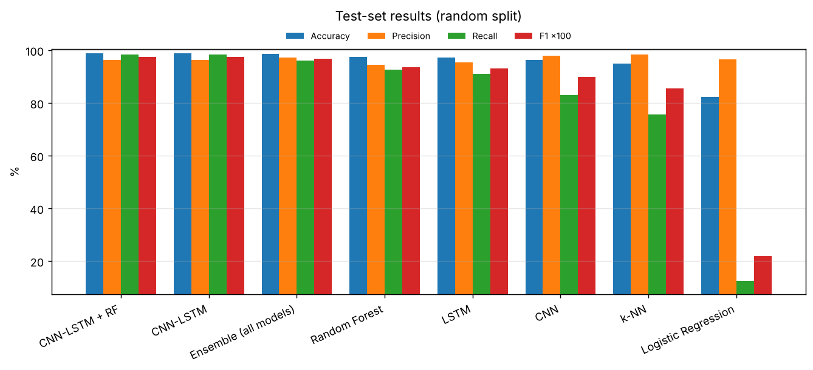
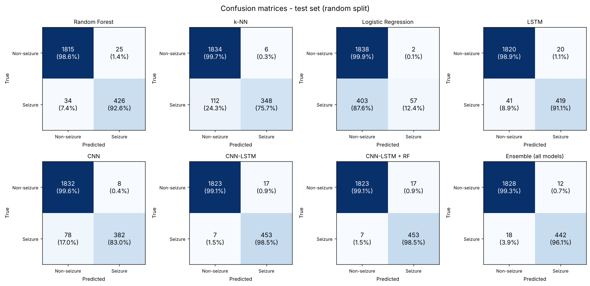
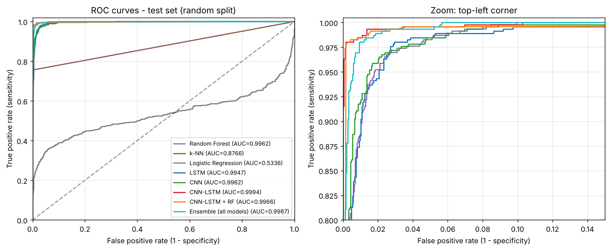
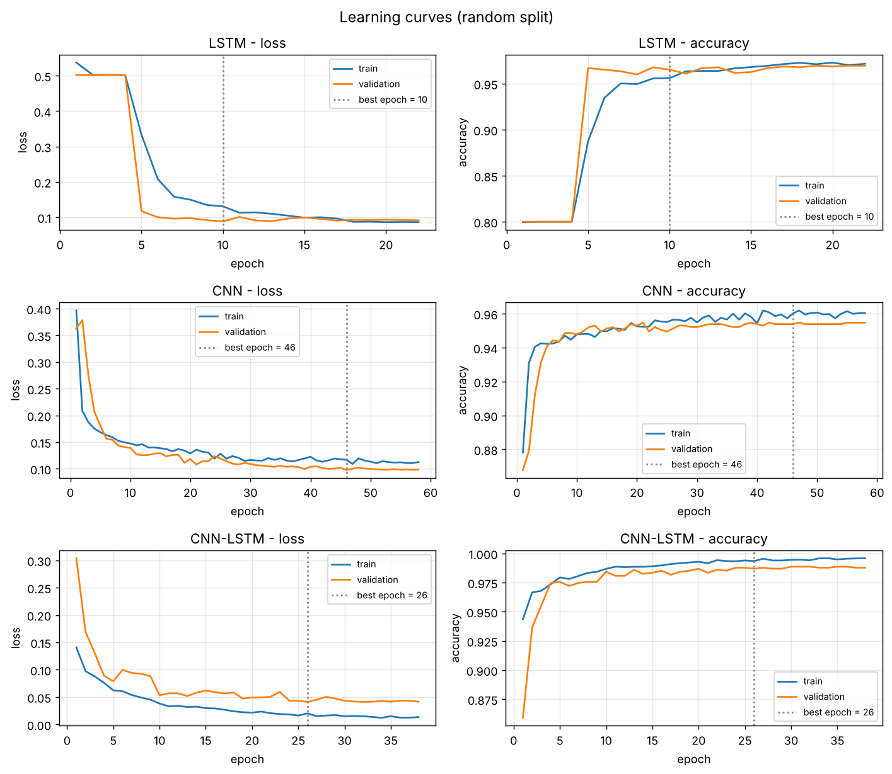
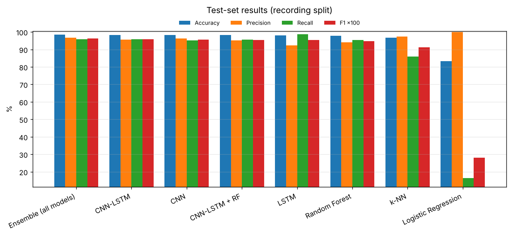

# 🧠 Epileptic Seizure Detection using Deep Learning

[](https://colab.research.google.com/github/apeksha9098/epileptic-seizure-detection/blob/main/notebooks/Epileptic_Seizure_Detection_Colab.ipynb)


Automatic detection of **epileptic seizures from EEG signals** with **LSTM, 1D-CNN and a CNN-LSTM hybrid**,
compared with **Random Forest, k-NN and Logistic Regression**, and with two ways of **combining machine learning and deep learning**.
Final-year project, Biomedical Engineering – Purbanchal University, College of Biomedical Engineering and Applied Sciences (CBEAS), Kathmandu.

> **Input:** 1 second of EEG (178 numbers)  →  **Output:** *seizure* or *no seizure*

## ✨ Highlights

* The **CNN-LSTM** is the best model: **98.96 % accuracy**, **98.5 % sensitivity** (found 453 of 460 seizure seconds) and only 17 false alarms in 1,840 normal seconds –
  with just **127,578 trainable parameters** (about 17× fewer than the 2.2 M-parameter model of the previous study quoted in the report).
* Tested **twice**: with the usual random split (as in the report) **and** with a stricter *recording split* in which the test recordings were never seen in training – the results stay close (see below).
* Everything is **reproducible with one command or one click** (Google Colab notebook), including a **Raspberry Pi** version that needs only NumPy.
* New in this repository: seizure-class metrics, 95 % confidence intervals, a machine-learning + deep-learning hybrid, and beginner-friendly guides in `docs/`.

## 📊 Results

All numbers are on **test data the models never saw**, for the **seizure class** (class 1, the thing we want to find). Seed 42, trained on CPU with TensorFlow 2.21; re-running can change numbers by about ±0.5 %.

### A) As in the project report – random split 70 : 10 : 20 (train : validation : test)

| Model | Accuracy % | Precision % | Recall % | Specificity % | F1 | ROC-AUC | Accuracy 95% CI | F1 95% CI |
|---|---|---|---|---|---|---|---|---|
| CNN-LSTM + RF | 98.96 | 96.38 | 98.48 | 99.08 | 0.974 | 0.997 | 98.2-99.5 | 0.955-0.988 |
| **CNN-LSTM** | 98.96 | 96.38 | 98.48 | 99.08 | 0.974 | 0.999 | 98.2-99.5 | 0.954-0.988 |
| Ensemble (all models) | 98.70 | 97.36 | 96.09 | 99.35 | 0.967 | 0.999 | 97.9-99.3 | 0.947-0.983 |
| Random Forest | 97.43 | 94.46 | 92.61 | 98.64 | 0.935 | 0.996 | 96.4-98.3 | 0.908-0.959 |
| LSTM | 97.35 | 95.44 | 91.09 | 98.91 | 0.932 | 0.995 | 96.2-98.4 | 0.903-0.958 |
| CNN | 96.26 | 97.95 | 83.04 | 99.57 | 0.899 | 0.996 | 94.6-97.6 | 0.855-0.935 |
| k-NN | 94.87 | 98.31 | 75.65 | 99.67 | 0.855 | 0.877 | 93.2-96.4 | 0.809-0.896 |
| Logistic Regression | 82.39 | 96.61 | 12.39 | 99.89 | 0.220 | 0.534 | 79.0-85.7 | 0.164-0.280 |






### B) Stricter check – the test contains only recordings never seen in training ("recording split")

| Model | Accuracy % | Precision % | Recall % | Specificity % | F1 | ROC-AUC | Accuracy 95% CI | F1 95% CI |
|---|---|---|---|---|---|---|---|---|
| Ensemble (all models) | 98.52 | 96.71 | 95.87 | 99.18 | 0.963 | 0.999 | 96.5-99.7 | 0.905-0.994 |
| CNN-LSTM | 98.30 | 95.66 | 95.87 | 98.91 | 0.958 | 0.992 | 96.3-99.6 | 0.898-0.990 |
| CNN | 98.30 | 96.26 | 95.22 | 99.08 | 0.957 | 0.997 | 95.8-99.9 | 0.891-0.996 |
| CNN-LSTM + RF | 98.17 | 95.24 | 95.65 | 98.80 | 0.954 | 0.980 | 96.0-99.5 | 0.893-0.989 |
| LSTM | 98.09 | 92.28 | 98.70 | 97.93 | 0.954 | 0.995 | 96.2-99.5 | 0.899-0.988 |
| Random Forest | 97.91 | 94.21 | 95.43 | 98.53 | 0.948 | 0.998 | 95.6-99.4 | 0.880-0.986 |
| k-NN | 96.70 | 97.29 | 85.87 | 99.40 | 0.912 | 0.926 | 93.7-98.8 | 0.835-0.966 |
| Logistic Regression | 83.26 | 100.00 | 16.30 | 100.00 | 0.280 | 0.501 | 76.5-89.7 | 0.201-0.357 |



### What do the results tell us?

1. **CNN-LSTM is the best model in protocol A** (F1 0.974, ROC-AUC 0.9994). Its confidence interval overlaps slightly with Random Forest and LSTM at the top end, so the ranking among those three should be stated with care; it is clearly better than CNN, k-NN and Logistic Regression.
2. **Deep learning beats classical machine learning** on raw EEG – except Random Forest, which is surprisingly strong (97.4 %). **Logistic Regression is almost useless** (ROC-AUC 0.53, close to guessing): one straight boundary cannot separate oscillating EEG waves.
3. **Combining ML and DL did not add accuracy.** A Random Forest on the 32 features learned by the CNN-LSTM agrees with the CNN-LSTM on 2,298 of 2,300 test seconds, and the voting ensemble (98.70 %) is statistically the same.
4. **The models work on unseen recordings.** In protocol B the deep models, the ensemble and Random Forest all score 97.9–98.5 % accuracy and their confidence intervals overlap almost completely – with 100 test recordings we cannot say which of them is best.
5. **Accuracy alone is misleading here:** always answering "no seizure" is already 80 % accurate. That is why precision, sensitivity, specificity and F1 are reported.

### Comparison with the previous study quoted in the report

| Study | Model | Trainable parameters | Accuracy % | Precision % | Recall % | F1 |
|---|---|---|---|---|---|---|
| Xu et al. (2020), as quoted in the report | CNN-LSTM | 2,232,320 | 99.39 | 98.39 | 98.79 | 0.9859 |
| **This project** (protocol A) | CNN-LSTM | **127,578** | 98.96 | 96.38 | 98.48 | 0.9742 |

Our accuracy interval (98.2-99.5 %) contains 99.39 %, so the two models are **comparable**; we do **not** claim to beat the previous study.
The goal written in the abstract (to exceed 99.6 % / 99.54 % accuracy) was **not reached**.

## 🚀 Quick start

**Google Colab (no installation, recommended)** – full guide in [`docs/1_RUN_ON_GOOGLE_COLAB.md`](docs/1_RUN_ON_GOOGLE_COLAB.md):
1. Click the **Open in Colab** badge above (or upload `notebooks/Epileptic_Seizure_Detection_Colab.ipynb` to https://colab.research.google.com).
2. Keep the **QUICK_TEST** box ticked for a first 3-minute test, then untick it for the real training (≈ 20–30 min for both protocols). If you opened the notebook from your own GitHub repository, type your username into the **GITHUB_USERNAME** box.
3. **Runtime → Run all**. The last cell downloads all results.

**On your own computer** (Python 3.10+):
```bash
git clone https://github.com/apeksha9098/epileptic-seizure-detection.git
cd epileptic-seizure-detection
pip install -r requirements.txt
python scripts/run_all.py --quick          # 2-minute test that everything works
python scripts/run_all.py --split both     # full training + evaluation (both protocols)
python scripts/predict.py --demo           # try the trained CNN-LSTM on 10 random EEG seconds
```
The training of the three deep models took about 8 minutes on one CPU core
(CNN-LSTM 6 min, CNN 1.2 min, LSTM 0.6 min).

## 📁 Project structure

```
epileptic-seizure-detection/
├── README.md                  this file
├── requirements.txt           libraries (Colab already has them)
├── data/data.csv              UCI / Bonn EEG data set (+ data/README.md with credit)
├── src/                       the code: config, data, models, train, ml, hybrid, evaluate
├── scripts/run_all.py         ONE command that runs everything
├── scripts/predict.py         use a trained model on new EEG data
├── notebooks/                 Google Colab notebook (step by step, with explanations)
├── results/                   tables, pictures and trained models (random_split/ and recording_split/)
├── raspberry_pi/              NumPy-only detector for Raspberry Pi + export tools
├── docs/                      beginner guides: Colab, GitHub, how it works, notes for the report
└── extras/                    the team's earlier BEED notebook (kept for reference)
```

## 🔬 How it works
Plain-language explanation (EEG, data set, models, metrics, why two splits): [`docs/3_HOW_IT_WORKS.md`](docs/3_HOW_IT_WORKS.md).

Models (exactly as in the report's Tables 1–3): **LSTM** (10 LSTM layers, 197,090 parameters) · **1D-CNN** (3 conv blocks, 8,626) · **CNN-LSTM** (2 conv + 5 LSTM layers, 127,578).
Training: Adam, categorical cross-entropy, batch 64, early stopping on validation loss, learning-rate reduction on plateau.

## 🍓 Raspberry Pi
`raspberry_pi/` contains a detector that runs the trained CNN-LSTM with **NumPy only** (about 7 ms per EEG second on the machine used here; it reproduces the Keras output to 7·10⁻⁷).
See [`raspberry_pi/README.md`](raspberry_pi/README.md). *Not yet tested on real Raspberry Pi hardware.*

## ⚠️ Limitations (please read)

* **Research prototype – not a medical device.** It has not been clinically validated.
* **One data set.** In the original Bonn recordings, healthy-volunteer EEG (sets A, B) is *surface* EEG, while the patient recordings (C, D, E) are *intracranial*; this can make the task easier than real clinical seizure detection.
* **No patient identifiers.** The recording split removes the overlap between the pieces of one recording, but several recordings come from the same few patients, so results for a completely **new patient** may be lower.
* **One split, one seed.** Differences below about one percentage point are within the confidence intervals and should not be over-interpreted.
* **Raspberry Pi** code was verified against the Keras model on a PC; it was not run on Pi hardware, and real EEG from another device would need the same sampling rate (173.61 Hz) and filtering.

## 📚 Data and references

* **Data:** R. G. Andrzejak et al., *Phys. Rev. E* 64, 061907 (2001) – University of Bonn; restructured 178-column version by Q. Wu and E. Fokoué, **UCI Machine Learning Repository** (2017). Details and credit in [`data/README.md`](data/README.md).
* **Previous study:** G. Xu, T. Ren, Y. Chen, W. Che, *A One-Dimensional CNN-LSTM Model for Epileptic Seizure Recognition Using EEG Signal Analysis* (2020).

## 👥 Team

Bhaskar Bhandari · Nirmal Basnet · Sabita Khadka · Saraswati Tamang · Shekhar Sharma · Sushant Koirala · Trisam Sapkota
*(supervision: Kamal K.C., Er. Sakar Niraula; project in-charge: Asst. Prof. Alaka Acharya)*

## 📄 License
Code: [MIT](LICENSE). The data set belongs to its original authors (see `data/README.md`).
