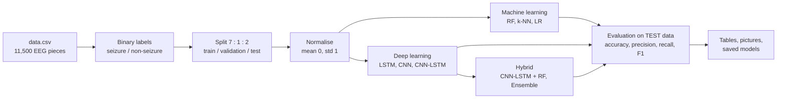

# 3. How the project works (in simple words)

## 3.1 The goal

An **EEG** (electroencephalogram) records the tiny electrical signals of the brain.
During an **epileptic seizure** the signal looks different – usually larger and more “violent”.
Doctors must look at hours of EEG to find seizures. **Our program does this automatically:**

> **Input:** 1 second of EEG (178 numbers)  →  **Output:** “seizure” or “no seizure”

Look at `results/figures/dataset_eeg_examples.png`: the red curve (seizure) is clearly different from the blue ones.

## 3.2 The dataset

* Source: **UCI “Epileptic Seizure Recognition”**, made from the **Bonn University** EEG recordings (Andrzejak et al., 2001).
* 500 recordings of 23.6 seconds. Each recording was cut into **23 pieces of 1 second** → 500 × 23 = **11,500 rows**.
* Each row = **178 numbers** (the EEG voltage) + a label `y`:

| `y` | Meaning | Seizure? |
|---|---|---|
| 1 | EEG **during a seizure** | **YES** |
| 2 | epilepsy patient, seizure-free time, recorded at the epileptogenic zone | no |
| 3 | epilepsy patient, seizure-free time, recorded at the hippocampal area (other side) | no |
| 4 | healthy person, eyes closed | no |
| 5 | healthy person, eyes open | no |

* **Binary problem:** class 1 → **1 (seizure)**, classes 2–5 → **0 (non-seizure)**.
  So we have 2,300 seizure rows and 9,200 non-seizure rows (the data is *imbalanced*: 20 % vs 80 %).

> **Why this matters:** a lazy program that always says “no seizure” would already be 80 % “accurate”. That is why we also look at **recall** and **precision**.

## 3.3 The steps of the program



### Normalisation
Every one of the 178 columns is shifted and scaled so that its average is 0 and its spread is 1.
Neural networks learn much faster with such numbers. The average/spread are calculated **only from the training data**
(otherwise information from the test data would “leak” into training).

### Train / validation / test = 7 : 1 : 2
Think of a student:

| Part | Share | Like … |
|---|---|---|
| **Training** | 70 % | the textbook the student learns from |
| **Validation** | 10 % | practice exams – used to decide when to stop learning and to choose settings |
| **Test** | 20 % | the **final exam** – used once, only to report the result |

## 3.4 The models

**Machine learning (classical)**
* **Logistic Regression** – draws one straight “wall” between the two classes. Simple, fast, but EEG is too complex for a straight wall.
* **k-Nearest Neighbours (k-NN)** – looks at the *k* most similar training signals and copies their label.
* **Random Forest (RF)** – 100–200 decision trees vote. Strong and robust.

**Deep learning**
* **LSTM** – a network with *memory cells* (gates decide what to remember/forget). 10 LSTM layers + 2 dense layers.
  *Good to know:* following the report, each sample enters the LSTM as **one step with 178 values**, so here the LSTM layers act like a deep network with gates.
* **1D-CNN** – small “filters” slide along the signal and detect shapes (spikes, waves). 3 convolution blocks + 2 dense layers.
* **CNN-LSTM (our best idea)** – convolution layers find the small waveforms, **then** LSTM layers follow how they change over time
  (2 conv + 5 LSTM + 2 dense layers, 127,578 trainable parameters).

**Training words you will see in the output**

| Word | Meaning |
|---|---|
| *Epoch* | one complete pass over all training data |
| *Batch* | a small group of samples (64) processed together |
| *Loss* | the error the network tries to make small (lower = better) |
| *Adam* | the method that adjusts the network’s numbers after every batch |
| *Dropout* | randomly switches off neurons during training → prevents learning by heart |
| *Batch normalisation* | keeps numbers inside the network well-behaved |
| *Early stopping* | stop when the validation loss no longer improves (and go back to the best epoch) |
| *Over-fitting* | the network knows the training data by heart but fails on new data (training curve ↑, validation curve ↓) |

## 3.5 How we judge the models

For the **seizure** class (positive):

```
                    Predicted: non-seizure    Predicted: seizure
True: non-seizure         TN                       FP  (false alarm)
True: seizure             FN (missed seizure)      TP
```

| Metric | Formula | Question it answers |
|---|---|---|
| **Accuracy** | (TP+TN) / all | How many decisions were correct? |
| **Precision** | TP / (TP+FP) | If the alarm rings, is it a real seizure? |
| **Recall / Sensitivity** | TP / (TP+FN) | How many real seizures did we find? *(most important in medicine)* |
| **Specificity** | TN / (TN+FP) | How many normal signals did we leave alone? |
| **F1-score** | 2·P·R / (P+R) | One number that balances precision and recall |
| **ROC-AUC** | area under the ROC curve | How well can the model separate the classes at *any* threshold (1.0 = perfect) |

## 3.6 Two ways of splitting – and why we do both

Every 1-second piece comes from a longer recording, and **neighbouring pieces continue each other**
(the last value of piece 5 flows into the first value of piece 6).

* **Random split** (what the report and most papers do): pieces are shuffled. Pieces of the **same recording** end up in training **and** in test.
  In principle this can make the test easier, because the model might “recognise the recording” instead of the seizure.
* **Recording split** (our check): **all 23 pieces of a recording stay together** – either all in training or all in test.
  Now the test contains only recordings the model has never seen.

The program prints *“recordings shared between train and test”* (498 of 498 with the random split, **0** with the recording split).

**What we found:** the results of the two protocols are **very close** (for example CNN-LSTM: 98.96 % accuracy with the random split,
98.30 % with unseen recordings; the confidence intervals overlap). So the good numbers are **not** just a trick of the random split –
the models also work on recordings they have never seen. Report the random-split numbers to compare with the report and other papers,
and add the recording-split table to show that you checked. (It is one split with 100 test recordings, so differences below
about one percentage point should not be over-interpreted – that is why the tables also show 95 % confidence intervals.)

**Confidence interval (95 % CI):** “the true value is very likely inside this range”. If the intervals of two models overlap a lot,
you cannot honestly say that one is better than the other.

## 3.7 Combining machine learning and deep learning (goal of the abstract)

1. **CNN-LSTM + RF:** the trained CNN-LSTM turns each EEG piece into 32 learned numbers; a Random Forest makes the final decision from them.
2. **Ensemble (soft voting):** LSTM, CNN, CNN-LSTM and Random Forest each give a probability; we average them.

## 3.8 Where is what? (code map)

| File | Purpose |
|---|---|
| `src/config.py` | all settings (epochs, batch size, split ratios, seed) |
| `src/data.py` | load data, binary labels, normalisation, both splits |
| `src/models.py` | the three neural networks (Tables 1–3 of the report) |
| `src/train.py` | training with early stopping, prediction |
| `src/ml.py` | Random Forest, k-NN, Logistic Regression + settings search |
| `src/hybrid.py` | CNN-LSTM + RF, ensemble |
| `src/evaluate.py` | metrics and pictures |
| `scripts/run_all.py` | **one command that runs everything** |
| `scripts/predict.py` | use a trained model on new EEG data |
| `notebooks/…Colab.ipynb` | the same project step by step in Google Colab |
| `raspberry_pi/` | run the trained network on a Raspberry Pi (NumPy only) |
| `results/` | tables, pictures and trained models produced by the training |

## 3.9 Glossary

**EEG** electroencephalogram · **Ictal** during a seizure · **Interictal** between seizures · **CNN** convolutional neural network ·
**LSTM** long short-term memory · **RF** random forest · **k-NN** k-nearest neighbours · **TP/TN/FP/FN** true/false positive/negative ·
**Sensitivity** = recall · **Hyper-parameter** a setting chosen by the programmer (e.g. number of trees) · **Seed** a number that makes “random” results repeatable.
